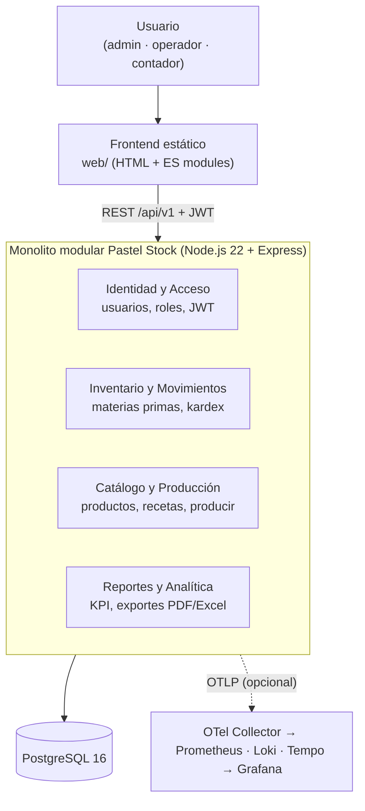
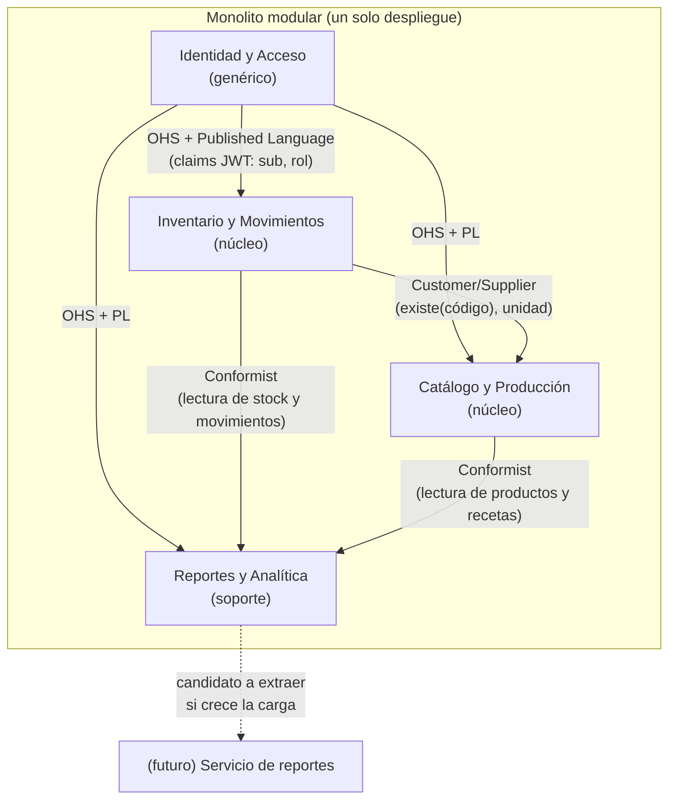
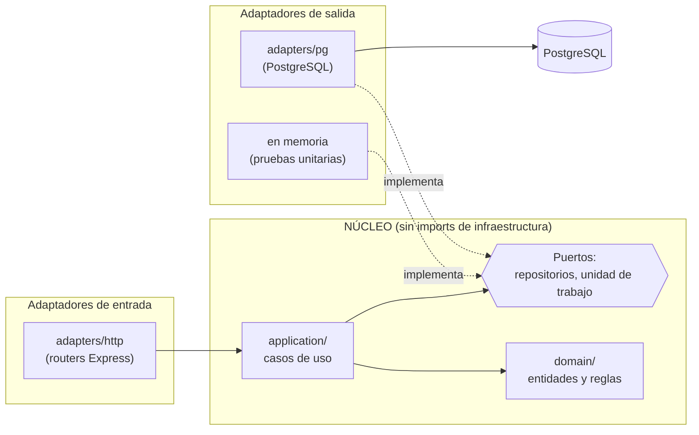
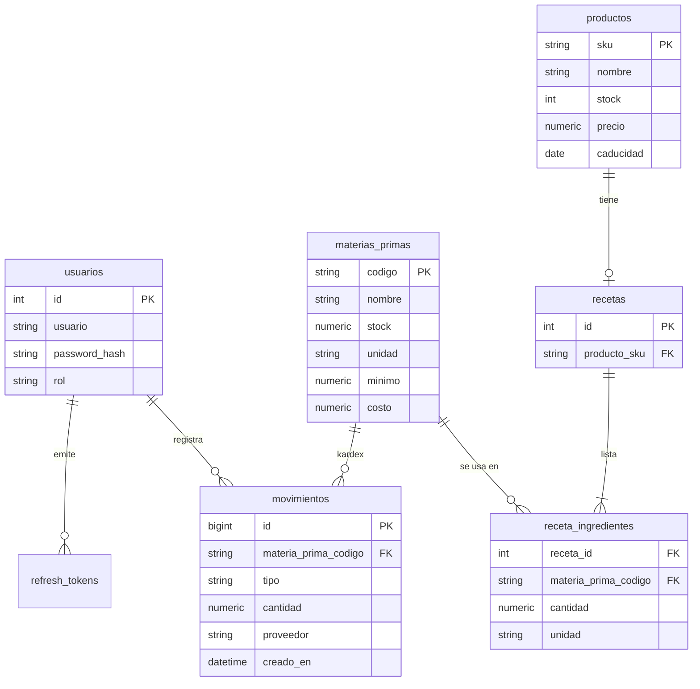
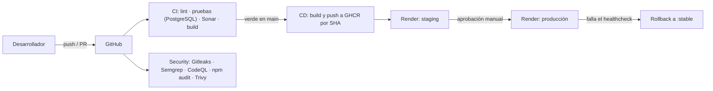

# Arquitectura de Pastel Stock

Resumen de las decisiones [ADR-03](adr/ADR-03-monolito-modular-con-api.md), [ADR-04](adr/ADR-04-monolito-modular-nucleo-hexagonal.md) y [ADR-05](adr/ADR-05-bounded-contexts-sin-distribuir.md). El contrato de la API es [`openapi/openapi.yaml`](../openapi/openapi.yaml) (fuente de verdad).

## Vista general

Un **monolito modular**: un solo despliegue (una imagen Docker) con cuatro contextos delimitados. El frontend es estático (`web/`) y consume la API REST `/api/v1`. No se distribuye en microservicios: el costo operativo superaría el margen de una MiPyme y no hay un atributo de calidad que lo justifique (ADR-05).



## Contextos delimitados y relaciones



Regla: cada contexto accede **solo a sus tablas** mediante su propio repositorio y se comunica con los demás a través de interfaces internas, no por consultas cruzadas.

## Núcleo hexagonal (puertos y adaptadores)

Dentro de cada contexto: `domain/` (entidades y reglas puras), `application/` (casos de uso) y `adapters/` (HTTP, PostgreSQL, exportadores). El dominio y los casos de uso **no importan infraestructura**; la raíz de composición ([`src/app.js`](../src/app.js)) es el único lugar donde se conectan.



## Estructura del repositorio

```text
web/                      Frontend estático (index.html, css/, js/ como módulos ES)
src/
  config.js               Configuración solo desde variables de entorno
  app.js                  Raíz de composición (helmet, rate limit, rutas, /health)
  server.js, telemetry.js Arranque, apagado ordenado y OpenTelemetry (opcional)
  identity/ inventory/ catalog/ reporting/   {domain, application, adapters}
  shared/                 Errores (RFC 9457), validación (Ajv), logger (pino), métricas
  db/                     Pool, migraciones SQL y siembra
openapi/openapi.yaml      Contrato OpenAPI 3.1
tests/                    unit/, integration/, contract/, web/
k6/                       Prueba de carga del endpoint crítico
obs/                      Collector, Prometheus, Loki, Tempo, Grafana, SLO
docs/                     ADR, deuda técnica, roadmap, SLO, runbooks, seguridad
.github/workflows/        ci.yml, cd.yml, security.yml, perf-manual.yml
```

## Modelo de datos



Reglas de integridad en la propia base: `stock >= 0`, `cantidad > 0` en movimientos, recetas enlazadas por código de materia prima, unidades normalizadas (g, ml, unid; docena = 12 unid).

## Flujo crítico: registrar una entrada

```mermaid
sequenceDiagram
  participant C as Cliente (operador)
  participant A as API (router + auth)
  participant U as Caso de uso registrarEntrada
  participant D as PostgreSQL
  C->>A: POST /api/v1/movimientos/entradas + Bearer JWT
  A->>A: autenticar (JWT) y autorizar (admin u operador)
  A->>A: validar cuerpo contra el contrato (cantidad > 0)
  A->>U: registrarEntrada(codigo, cantidad, proveedor, usuario)
  U->>D: BEGIN; UPDATE stock (fila bloqueada); INSERT movimiento; COMMIT
  D-->>U: stock nuevo y id del movimiento
  U-->>A: stock, estado, movimientoId
  A-->>C: 201 Created
```

La actualización de stock y el movimiento ocurren en **una transacción**: nunca hay stock sin kardex ni kardex sin stock (corrige DT-08).

## Despliegue



## Decisiones y trade-offs principales

| Decisión | Por qué | Costo asumido |
|---|---|---|
| Monolito modular, no microservicios | Una persona opera el sistema; el costo y la complejidad de distribuir superan el beneficio | Escalado por contexto no es independiente (se reevalúa con el disparador del roadmap) |
| PostgreSQL en vez de `localStorage`/NoSQL | Integridad transaccional del stock y kardex auditable | Requiere gestionar una base de datos y respaldos |
| JWT de vida corta + refresh rotativo | Autorización en el servidor sin sesiones en memoria | Revocar un access token antes de su vencimiento no es inmediato (15 min) |
| Exportes PDF/Excel en el servidor | Se eliminan las librerías con CVE del navegador | Mayor uso de CPU en el servidor (candidato a extraer) |
| Observabilidad opcional con OpenTelemetry | Medir el SLO sin atarse a un proveedor | El stack completo pide ≈ 1,2 GB de memoria; se usa en un host aparte o en local |
